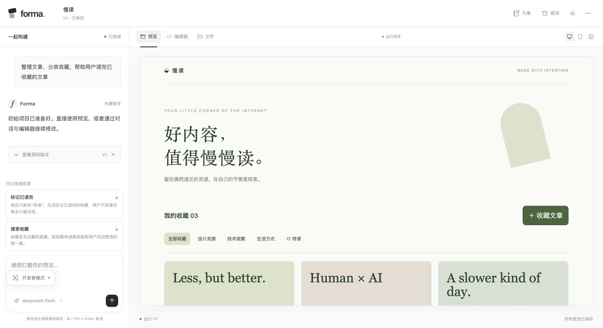
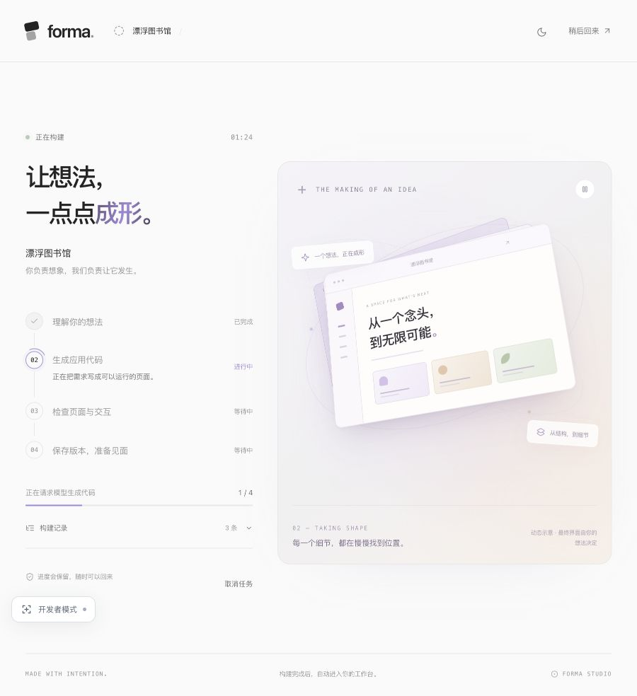
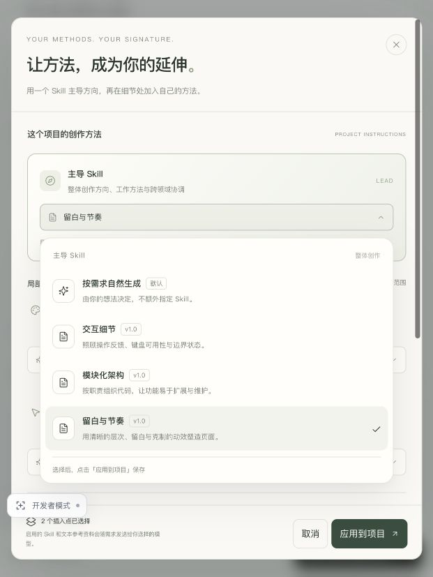

<h1 align="center">Forma</h1>

<p align="center"><strong>让想法，有了形状。</strong><br>用自然语言构建应用，在同一个工作空间里预览、修改和继续打磨。</p>

<p align="center">
  <a href="#快速开始"></a>
  <a href="#快速开始"></a>
  <a href="#工程结构"></a>
  <a href="#模型接入"></a>
  <a href="#skill-扩展"></a>
</p>

<p align="center">
  <a href="https://forma.179-253-234-78.sslip.io:18443/"><strong>在线体验 ↗</strong></a> ·
  <a href="docs/submission-draft.md">项目说明</a> ·
  <a href="docs/architecture.md">架构设计</a> ·
  <a href="SECURITY.md">安全说明</a>
</p>

<p align="center">
  
</p>

Forma 是一个从想法到可运行小应用的工作空间。写下需求，选择模型，生成第一版；接着可以用对话修改，也可以直接编辑源码。项目文件、版本和应用数据都保存在服务端，关掉页面后还能回来继续。

当前聚焦无需安装依赖的 **HTML / CSS / JavaScript 应用**，已完成账号、生成、预览、编辑、版本与恢复的完整流程。平台模型和自带 Key 模式会真实调用 AI；基础示例是单独标注的模板体验模式。

```bash
python3 -m backend
```

<p align="center"><a href="#产品一览">产品一览</a> · <a href="#快速开始">快速开始</a> · <a href="#模型接入">模型接入</a> · <a href="#skill-扩展">Skill 扩展</a> · <a href="#工程结构">工程结构</a> · <a href="#部署与运维">部署与运维</a> · <a href="#验证与边界">验证与边界</a></p>

## 产品一览

**一个空间，完成从第一版到下一版。** 左侧沟通需求，右侧查看实际运行效果；源码、文件和历史版本随时可查。

<p align="center">
  
</p>

> 实际工作台截图 · 基础示例「阅读收藏夹」，展示预览、对话和项目优化建议。

| 想做什么 | Forma 如何支持 |
| --- | --- |
| 把想法做出第一版 | 名称与自然语言需求形成简报，确认后启动构建，不要求先选应用类型或视觉风格 |
| 继续调整应用 | 对话基于现有源码修改；优化建议结合当前项目与版本生成，点击后先填入草稿 |
| 自己改代码 | CodeMirror 编辑实际项目文件；保存草稿后检查 HTML、CSS、JavaScript，再更新预览 |
| 看清每次改动 | 完整源码版本、文件差异和历史预览；恢复源码新增版本，保留应用数据 |
| 暂停后接着做 | 持久化任务会话和源码检查点，重新打开项目可以恢复；离开页面不终止任务 |
| 换模型或带上自己的方法 | 支持自带 API Key、5 种模型协议，以及主导和局部 Skill 插入点 |
| 管理文件与带走成果 | 文件夹上传、浏览、下载，以及附带本地数据适配器的源码 ZIP 导出 |

<table>
  <tr>
    <td width="53%" valign="top"></td>
    <td width="47%" valign="top"></td>
  </tr>
  <tr>
    <td><strong>等待时，也知道进展。</strong><br>任务阶段来自后端事件；右侧为动态示意，支持暂停和减少动态效果。</td>
    <td><strong>把自己的方法带进来。</strong><br>一个主导 Skill 统筹方向，局部 Skill 补充具体领域的方法。</td>
  </tr>
</table>

界面支持浅色 / 深色、响应式布局与减少动态效果。工作台对话栏可调整宽度，元素检查器可拖动，方便反馈具体位置的问题。

## 快速开始

需要 **Python 3.11+** 和 **Node.js 18+**。Python 服务使用标准库；Node 用于 CSS 解析和 JavaScript 语法检查，不执行生成的程序。校验依赖与许可证已随仓库提供，无需额外安装 pip 或 npm 包。

```bash
git clone https://github.com/wrc093/atoms-demo.git
cd atoms-demo
python3 -m backend
```

打开 [localhost:8770](http://127.0.0.1:8770/)，注册账号后新建项目。首页可匿名浏览，项目、生成、编辑器及相关 API 都要求登录。

- **直接体验流程**：选择「基础示例」，不需要模型 Key。支持已有阅读、待办、作品集示例；自由生成请切换模型。
- **使用自己的模型**：在方案页选择「使用自己的 API Key」，连接服务后构建。
- **提供平台模型**：复制 `.env.example` 为 `.env`，填写服务配置后重启，详见下节。

默认数据库为 `.data/forma.sqlite3`；`.env`、运行数据和临时产物均不提交 Git。请使用 `python3 -m backend` 或 `make dev` 启动，普通静态文件服务器无法提供账号和生成能力。

## 模型接入

平台模型与 BYOK 共用协议适配和源码校验。服务目录与协议实现位于 `backend/model_adapters.py`，前端从后端获取目录。

| 协议 | 常见接入对象 |
| --- | --- |
| Chat Completions | DeepSeek、OpenAI 兼容网关等 |
| Responses | OpenAI 及兼容服务 |
| Anthropic Messages | Claude |
| Google Generative AI | Gemini 原生接口 |
| Azure OpenAI Responses | Azure 模型部署，API Key 认证 |

界面提供 DeepSeek、OpenAI、Anthropic、Google、Azure OpenAI、OpenRouter、通义千问、Moonshot、智谱、Groq、Mistral、xAI 和 MiniMax 预设，也支持自定义 HTTPS Base URL。预设只是连接建议，具体模型权限取决于账号。DeepSeek 已完成真实调用验证，其余协议通过本机模型替身验证请求与生成链路，不代表每家厂商都已实测。

**用户 Key 只保存在服务进程内存中**，按用户隔离，不写入 SQLite、浏览器存储、项目或源码。退出、移除连接或服务重启会清除；已经提交的任务使用提交时的连接。保存连接仅检查配置，首次构建才验证真实服务和 Key，费用由对应账号承担。

<details>
<summary><strong>平台配置、协议参数与凭据引用</strong></summary>

将 `.env.example` 复制为 `.env`，按服务填写。以 DeepSeek 为例：

```dotenv
FORMA_MODEL_BASE_URL=https://api.deepseek.com
FORMA_MODEL=deepseek-flash
FORMA_MODEL_API=chat_completions
FORMA_MODEL_API_KEY=填写你自己的Key
```

目前支持 5 种协议，同样可通过服务端 `FORMA_MODEL_API` 配置：

| 协议值 | 接口与认证 | Base URL 示例 |
| --- | --- | --- |
| `chat_completions` | `/chat/completions`，Bearer Key | `https://api.deepseek.com` |
| `responses` | `/responses`，Bearer Key | `https://api.openai.com/v1` |
| `anthropic-messages` | `/v1/messages`，`x-api-key` 和 Anthropic 版本头 | `https://api.anthropic.com/v1` |
| `google-generative-ai` | `/models/模型:generateContent`，`x-goog-api-key` | `https://generativelanguage.googleapis.com/v1beta` |
| `azure-openai-responses` | `/responses`，`api-key` | `https://你的资源.openai.azure.com/openai/v1` |

Azure 模型名称填写部署名称，当前只支持 API Key，不包含 Entra ID 登录。后端也接受 pi 的 `openai-completions`、`openai-responses` 名称，映射到既有协议。Vertex、Bedrock 和 OAuth/订阅登录暂未接入，当前支持上述 API Key 协议。所有预设模型都是可修改的建议，不代表当前 Key 一定拥有该模型权限。

Provider 与协议分层参考 [pi-ai](https://github.com/badlogic/pi-mono/tree/main/packages/ai)：服务目录和协议适配集中在 `backend/model_adapters.py`，前端从登录后的模型连接 API 获取目录。不同协议独立构造请求与解析响应，再统一交给源码校验与版本提交。Anthropic 使用带源码 Schema 的强制工具输出，兼容服务返回完整 JSON 文本时也可解析；Gemini 使用原生 JSON Schema 输出并排除思考文本；截断、安全拦截和无效项目会失败，不保存为成功版本。Gemini Key 放在请求头中，模型名编码成路径段，禁止将 Key 放入 URL。

Key 不会出现在 API 响应、浏览器存储、日志或源码导出中。`.env` 和 `.data/` 已加入 `.gitignore`，也不能经静态文件接口访问。变更服务端配置后需要重启。

协议依据：[Gemini GenerateContent](https://ai.google.dev/api/generate-content)、[Azure Responses](https://learn.microsoft.com/en-us/azure/ai-foundry/openai/how-to/responses?view=foundry-classic)、[DeepSeek JSON Output](https://api-docs.deepseek.com/guides/json_mode/)、[OpenAI Structured Outputs](https://developers.openai.com/api/docs/guides/structured-outputs)。兼容模式使用 JSON Output，服务端仍独立校验结构和源码。

可选的 `FORMA_MODEL_PI_PROVIDER=deepseek` 只引用本机 `~/.pi/agent/auth.json` 中指定 Provider 的 `api_key`，不会自动扫描其他凭据。换机器时需配置自己的 Key 或凭据来源。

用户自定义地址经过公网校验，请求绑定已校验的 IP，保留 TLS 主机名与证书校验，拒绝重定向。具体网络与 SSRF 防护见 [SECURITY.md](SECURITY.md)。

</details>

## Skill 扩展

在「我的 Skill」上传 Markdown 或包含 `SKILL.md` 的 ZIP，在方案页或工作台绑定到项目：

| 插入位置 | 作用 |
| --- | --- |
| 主导 Skill | 整体创作方向、工作方法与领域约定 |
| 视觉风格 | 布局、字体、色彩与动效方法 |
| 应用架构 | 文件组织、模块边界与数据设计 |
| 功能与交互 | 操作流程、反馈和异常状态 |
| 质量检查 | 验收、可用性与质量要求 |

插入点默认留空，按需配置；不会让用户先在固定风格或应用类型中做选择。[下载 Skill 模板](frontend/assets/skills/SKILL.md)。

Skill 接入的是**指令与参考资料层**。启用的正文和文本参考会发送给所选模型，包内脚本不执行，远程引用不读取，未知元数据不等于工具授权。优先级为：平台运行约束 → 本次明确需求 → 对应局部 Skill → 主导 Skill → 默认习惯。

<details>
<summary><strong>包格式、任务快照与扩展新的插入点</strong></summary>

支持 UTF-8 Markdown、YAML frontmatter、单层 ZIP 包装目录和相对路径参考文件。未知元数据及二进制附件保留供下载；包不解压到主机文件系统。相同内容复用记录，更新内容生成独立指纹。

任务启动时冻结 Skill 正文、参考资料、范围、版本和 SHA-256 指纹。自动修复与中断恢复沿用原快照，修改配置或移出个人库只影响后续任务。基础示例不执行模型指令，选择 Skill 后需要使用平台模型或 BYOK。

单包最多 2 MB / 64 个文件，入口正文最多 64 KB；所选文本总计 160 KB，连同源码不超过 350 KB 上下文。个人库最多 40 条 / 16 MB，平台最多 2,000 条 / 128 MB；移出的历史记录仍计入存储配额。导入并发限为 2，拒绝路径穿越、凭据文件、符号链接、加密包、重复路径与超量解压。

插入点集中注册在 `backend/skills.py`。服务启动时增加注册后，目录 API、前端选择、服务端校验和模型上下文会共同支持新位置，无需逐个修改 Provider：

```python
register_point('copywriting', '文案方法', '页面文案与语气')
```

</details>

## 工程结构

前端按页面与共享组件组织，后端承担鉴权、任务和存储。浏览器通过同源 `/api` 交互；开发时可拆开运行，部署时也可由后端直接托管前端。职责划分与取舍见 [架构设计](docs/architecture.md)。

```text
frontend/
├── index.html, workbench.html   产品流程与工作台入口
├── src/
│   ├── app/                    路由、基础样式与主题
│   ├── pages/                  首页、方案、构建、工作台
│   ├── components/             模型连接、选择器、Skill 等共享组件
│   ├── api/                    API 客户端与会话初始化
│   ├── shared/                 共享动效
│   └── devtools/               元素检查工具
├── assets/                     字体、浏览器库、Skill 模板与许可证
├── scripts/                    开发、检查与静态发布
└── tests/                      前端回归测试
backend/
├── server.py                   HTTP/API、鉴权与静态托管
├── core.py                     存储、项目、任务与模型调用
├── compiler.py                 源码校验、预览隔离与运行数据桥
├── model_adapters.py           Provider 目录与协议适配
├── skills.py                   个人库、插入点与任务快照
├── vendor/                     HTML/CSS 校验依赖与许可证
└── tests/                      集成、安全与协议测试
deploy/                         反向代理模板、Service Base 插件与打包
docs/                           项目说明、架构与展示资源
```

| 命令 | 用途 |
| --- | --- |
| `make dev` | 同源运行，默认 `127.0.0.1:8770` |
| `make backend` | 只启动 API，默认 8770 |
| `make frontend` | 独立前端，默认 5173，`/api` 代理到 8770 |
| `make check` | 前端语法与工程检查 |
| `make test` | 后端集成测试与前端回归测试 |
| `make build` | 生成 `frontend/dist/` 静态发布目录 |
| `make service-plugin` | 构建 Service Base 插件包 |

前端采用原生 HTML / CSS / JavaScript，无转译步骤。静态发布目录仅包含浏览器需要的 HTML、`src/` 和 `assets/`，不包含测试、数据库、后端或凭据。独立前端不读取后端 `.env`，可用 `FORMA_FRONTEND_PORT` 和 `FORMA_API_ORIGIN` 调整开发代理。

<details>
<summary><strong>主要 API</strong></summary>

写请求要求 `X-Forma-Request: 1` 并检查 Origin；项目接口同时校验所属账号。

| 接口 | 用途 |
| --- | --- |
| `POST /api/bootstrap` | 恢复会话；匿名返回空用户和项目，不创建访客 |
| `POST /api/auth/register`、`login`、`logout` | 注册、登录和退出 |
| `GET/POST /api/projects` | 列表和创建 |
| `GET/PATCH /api/projects/:id` | 详情、方案和收藏 |
| `GET/PUT /api/projects/:id/files` | 文件读取、保存和上传 |
| `GET/PUT/DELETE /api/model-connection` | 当前用户的内存模型连接 |
| `GET/POST /api/skills`、`GET/DELETE /api/skills/:id`、`GET .../export` | 个人 Skill 库、导入与导出 |
| `GET/PUT /api/projects/:id/skills` | 项目 Skill 配置 |
| `POST /api/projects/:id/generate` | 创建模型或基础示例任务 |
| `GET /api/jobs/:id`、`POST .../cancel`、`POST .../resume` | 进度、中断与恢复 |
| `POST /api/projects/:id/build` | 校验草稿，保存源码版本 |
| `GET/POST /api/projects/:id/suggestions` | 读取 / 生成版本优化建议 |
| `GET .../versions`、`POST .../restore` | 查看与恢复源码版本 |
| `GET .../preview`、`GET/PUT .../runtime` | 隔离预览与应用数据 |
| `GET /api/projects/:id/export` | 导出独立运行的源码 ZIP |

</details>

<details>
<summary><strong>前端元素检查器</strong></summary>

点击「开发者模式」或按 `Alt + Shift + D` 开启。悬停显示元素 ID、CSS 定位路径和尺寸；`Alt + 点击` 固定，`Esc` 退出。复制信息包含路由与元素位置，不读取输入内容。

按钮支持鼠标 / 触控拖动，位置保存在当前浏览器；聚焦后可用 `Alt + 方向键` 微调。工作台支持检查宿主界面，隔离的生成应用显示 iframe 容器位置，内部源码请在项目编辑器定位。

</details>

## 部署与运维

[打开在线演示](https://forma.179-253-234-78.sslip.io:18443/)，注册账号即可体验。真实生成可使用平台模型或自己的 Key，无 Key 时可选择基础示例。

当前演示部署路径：浏览器 → VPS 的 Caddy HTTPS 入口 → FRP STCP 私有通道 → Mac 主机上的应用。TLS 证书由 Caddy 自动申请和续期；FRP visitor 只监听 VPS 的回环地址，没有新增直接访问后端的公网端口。应用和数据继续保留在本机，现有 FRP 通道保持独立运行。

### Service Base 插件

本机应用作为 `forma-demo` 插件接入现有 Service Base，由基座负责登录后启动、心跳检查、故障重启和子进程回收。健康检查同时验证 `/api/health` 和匿名 `/api/bootstrap`，通过后才报告 ready，后台每 10 秒检查一次；FRP 子进程退出或应用持续不健康时，由基座重新拉起插件。端口预检允许正常的 TIME_WAIT 复用，仍会拒绝已有监听进程。

当前 FRP 使用直连，并配置 `loginFailExit = false`，连接中断后由隧道进程重试，避免本机代理切换导致应用反复重启。其他部署环境可按网络条件选择代理，隧道认证与 STCP 访问限制仍需保留。

Mac 上插件运行期间默认用系统 `caffeinate` 阻止空闲休眠，屏幕仍可关闭；配置 `keep_awake=false` 可关闭这一行为。关闭终端不影响服务。电脑需接电、开机并联网；手动休眠、合盖、关机或网络中断仍会影响访问。当前地址作为交付入口保留，日常更新只替换插件快照，不更换域名或端口。

插件协议适配器和可复现的打包脚本位于 `deploy/service-base/`。打包只复制运行代码和前端文件；模型配置、数据库和隧道认证配置通过路径引用，不进入源码仓库或插件包。

```bash
# 使用本机已有数据和配置构建插件；基座本身需事先安装。
python3 deploy/service-base/build.py \
  --env-file "$PWD/.env" \
  --database "$PWD/.data/forma.sqlite3" \
  --public-url "https://你的公网域名" \
  --frpc-binary "/绝对路径/frpc" \
  --frpc-config "/私有配置目录/frpc.toml"

# install 相同 ID 会更新该插件的快照，不重启基座或其他插件。
~/.local/bin/service-base install "$PWD/build/service-base"
~/.local/bin/service-base status
~/.local/bin/service-base logs forma-demo
~/.local/bin/service-base restart forma-demo
```

首次从手动启动迁移时，应先确认没有运行任务，备份 SQLite，再停止已确认的旧应用进程，避免两个实例争用同一端口。未配置 FRP 时，插件也能单独托管本地应用。安装后的配置更新使用基座的 `configure` 命令；代码改动后需要重新打包和 install，源码目录修改不会自动替换已安装快照。

### HTTPS 入口与会话配置

当前 VPS 的入口配置位于 `/opt/forma-edge/Caddyfile`，FRP visitor 私有配置位于 `/opt/forma-edge/visitor.toml`，分别由 `forma-edge` 和 `forma-frp-visitor` 两个 systemd 服务管理。HTTPS 使用 18443，80 用于证书签发，原有 443 服务保持独立。visitor 仅绑定 `127.0.0.1:18770`，通过 STCP 连接到本机的 8770；不要把 visitor 改成公网监听。本机隧道配置保存在 `.data/frp/frpc.toml`，随应用一起由插件管理。

公网域名需要通过 `FORMA_PUBLIC_URL` 配置，公网会话 Cookie 才会带 Secure 标记。插件同时启用 `FORMA_ALLOW_LOCAL_ACCESS=1`，允许这台电脑通过 `http://127.0.0.1:8770/` 登录；仅连接来源与 Host 都是本机、且没有代理头时采用本机会话规则。公网 Host 仍要求代理地址校验，公网 Cookie 保留 Secure。独立运行默认不开启该例外。使用独立环境文件时可设置 `FORMA_ENV_FILE`。只有明确受信的边缘代理可以覆盖 `X-Real-IP`；隧道密钥、服务端 token 和证书私钥保存在各机器的私有配置目录，不写进 Git。平台模型的应用内任务额度已启用，费用硬上限和上游 DDoS 防护仍需结合服务商配置。

仓库里的 `deploy/nginx.conf.example` 是另一种前后端静态分离部署的参考模板。本机当前实际使用 Caddy + FRP，Nginx 模板未在目标环境运行验证。

### 故障排查与备份

如果公网访问异常，先检查本机插件和 `/api/health`，再在 VPS 上检查入口与隧道：

```bash
curl --fail http://127.0.0.1:8770/api/health
# 以下命令在 VPS 上执行
systemctl status forma-edge forma-frp-visitor
journalctl -u forma-edge -u forma-frp-visitor -n 100 --no-pager
/opt/forma-edge/caddy validate --config /opt/forma-edge/Caddyfile --adapter caddyfile
```

备份运行中的 SQLite 时使用 SQLite backup API 或 `.backup`，不要只复制主数据库文件而漏掉 WAL。备份、环境文件和 FRP 密钥应存放在私有目录；当前尚未配置定期异地备份。

## 验证与边界

```bash
make check
make test
make build
```

最近一次完整验证：**124 项后端测试、24 项前端测试通过**。测试使用临时数据库和本机模型替身，不读取真实 Key，也不产生模型费用。覆盖账号隔离、CSRF、路径校验、模型协议、源码失败保留旧预览、版本恢复、任务中断、并发限制与 Skill 快照等场景。

**源码、预览和数据各自有边界。** 编辑保存先保留草稿，检查通过后才更新成功版本；失败时显示文件与行列，继续运行上一次成功预览。HTML、CSS 和外部 JS 均做相应结构或语法检查；CSS 覆盖 `.css`、`<style>` 与 `style` 属性。静态检查不等于交互、布局和浏览器兼容性已经验证。更新预览不调用 AI，也不会重新提交最初的需求。

**生成代码运行在浏览器沙箱。** 后端不执行生成程序；预览 iframe 不开放同源权限，CSP 限制联网、外部表单和远程脚本。应用通过 `FormaStore` 读写服务端运行数据，宿主校验来源与随机令牌；恢复源码不会删除运行数据与上传文件。导出副本使用浏览器本地存储，不包含平台账号或服务端数据。

应用数据键名由后端统一定义，并提供给工作台、预览桥和生成上下文：支持 1–80 位字母、数字、点号、冒号、下划线与短横线，拒绝原型保留名称。已有 `todo.tasks.v1` 等键名保持原样，无需改名或迁移。`FormaStore.set` 只在服务端确认后完成；失败时保留最后确认值，工作台持续显示“应用数据未保存”，并为已接收的有效写入保留当前页面内的重试快照。刷新或关闭页面前应先确认保存成功。具体复验步骤与结果见 [应用数据保存验收](docs/runtime-storage-verification.md)。

**恢复是应用层会话复用。** 已有完整源码检查点时继续校验，未取得完整输出时按原需求重新请求模型，不是 Provider 原生 token 续传。BYOK 在重启后需重新连接；源码发生变化时拒绝覆盖恢复。同一项目不允许重叠生成，单用户最多 3 个运行任务；主动中断释放用户名额，但已经发出的请求仍可能收尾。全局物理槽位为 3，队列上限为 12。

**当前是单机 Demo。** 暂未实现邮箱验证、密码找回、团队协作、任意服务端代码或 npm 工程构建，也未配置多实例任务队列、定期异地备份和持续监控。应用内的鉴权、限流和资源配额不能抵御带宽层 DDoS；公开部署还需上游 CDN/WAF、源站防火墙与费用硬额度。安全加固和受控攻击结果见 [SECURITY.md](SECURITY.md)。

<details>
<summary><strong>数据、配额与旧版本兼容</strong></summary>

SQLite 保存密码哈希（scrypt）、散列会话令牌、项目方案、文件修订、源码版本、任务事件和应用数据；浏览器只持有 HttpOnly 会话 Cookie。源码使用修订号避免过期页面覆盖；成功文件与版本在同一事务内提交。

单个上传文件上限 5 MB、项目文件总量 25 MB；生成源码最多 40 个文件 / 2 MB。恢复记录每会话上限 4 MB、全局 128 MB，不存模型 Key 或原始响应。上传不会写到任意主机路径。

优化建议随成功版本缓存。构建时可与源码一起返回，手动构建或旧项目则按需后台补生成；点击只填入可编辑草稿。补生成与构建共用物理槽位，最多输出 1200 tokens，失败后至少间隔 60 秒；24 小时内平台建议每用户最多 8 次、全局 24 次，所有模式每用户最多 30 次，BYOK 全局最多 100 次。建议额度耗尽不影响手动输入需求。

旧访客 Cookie 不再授予工作空间权限。当前浏览器注册或登录时可迁移原访客项目；旧原型的 localStorage / IndexedDB 不自动导入服务端。界面偏好继续保存在浏览器，项目以服务端数据为准。

</details>
