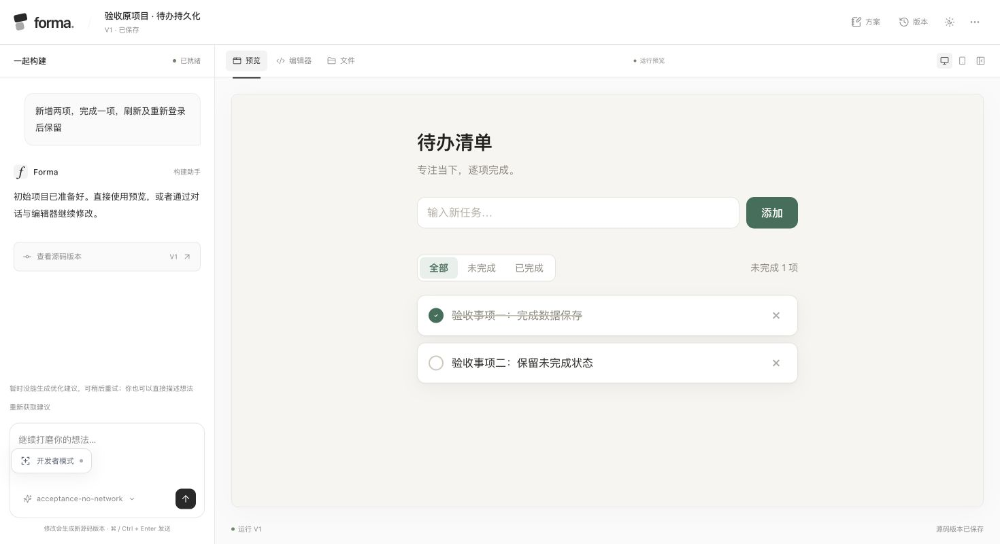
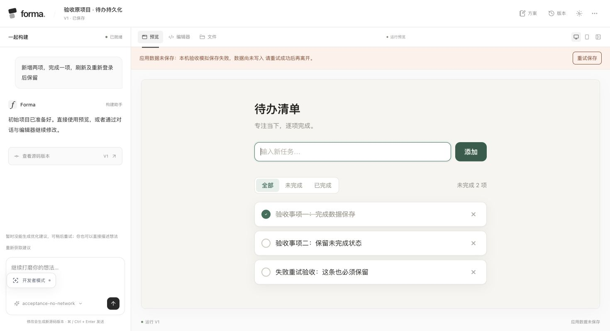
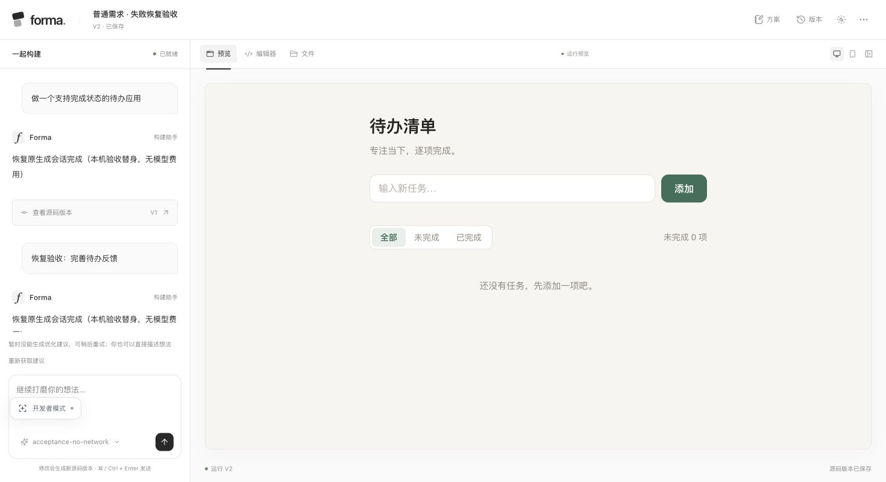

# 应用数据保存验收

验证日期：2026-10-26。

## 问题与修复

验收待办使用 `todo.tasks.v1`、`todo.filter.v1` 保存数据。原工作台和 API 只允许字母、数字、下划线、短横线，拒绝了带点号的键名；生成应用又忽略了 Promise 错误，造成页面变化、刷新后丢失。

本次修复覆盖生成约定、预览桥、工作台和 API：

- 存储规则集中在 `backend/runtime_storage.py`，通过登录初始化提供给工作台，同时注入预览与模型上下文。支持常见的点号和冒号命名，仍拒绝原型保留名称；键名是 SQLite 中的普通值，不作为文件路径使用。
- 已有键名保持原样，不修改验收项目源码，也不迁移已有应用数据。
- `FormaStore.set` 等待服务端确认后才完成，并更新本地已确认值。失败不会变成成功返回，历史预览写入也会明确拒绝。
- 工作台独立显示保存中、未保存和已保存状态。网络失败等可重试写入保留当前页面中的最新快照，提供“重试保存”，同一键的旧失败不会覆盖后来的修改。
- 生成上下文明确要求等待保存确认、处理异常并保留输入。已有应用即使忽略异常，工作台仍会独立展示未保存提示。
- 生成完成后通过新文档进入工作台，重新初始化账号和项目状态，避免恢复后只挂载出空白 iframe。

重试快照保存在当前工作台内存中；刷新或关闭前应先确认保存成功。此前从未写入服务端、且已随页面关闭丢失的数据，不能由这次修复还原。

## 浏览器验收

使用本次验收项目成功版本的原始源码，在本机隔离数据库中建立副本，避免向评审项目添加测试事项。隔离服务绑定回环地址，不读取真实模型 Key；保存失败使用受控服务错误，生成恢复使用本机模型替身。这里验证的是持久化和恢复链路，不将模型替身结果当作真实 AI 生成效果。

| 操作 | 结果 |
| --- | --- |
| 新增两项，完成第一项 | 两条事项保存到 `todo.tasks.v1`，第一条 `done=true`，第二条 `done=false` |
| 刷新页面 | 两条事项及完成状态保留 |
| 返回项目列表，再次进入 | 两条事项及完成状态保留 |
| 退出账号、重新登录、进入项目 | 两条事项及完成状态保留 |
| 模拟保存接口失败，新增第三项 | 工作台持续显示“应用数据未保存”，不显示数据已保存，并提供重试按钮 |
| 恢复保存接口，点击“重试保存” | 保存同一份最新快照，提示更新为已保存；刷新后第三项保留 |
| 普通需求生成失败后点击“恢复生成” | 沿用原生成会话，建立新的任务记录；成功保存版本后自动打开可运行工作台 |

退出重登后的页面：

模拟保存失败时的页面：

恢复后自动打开工作台：

上线复核：公网首页与健康检查返回 HTTP 200，新版存储组件与构建页资源和仓库源码一致；原验收项目的源码指纹与更新前相同，数据库更新前已备份。

## 自动化验证

执行 `make check`、`make test`、`make build`。124 项后端测试、24 项前端测试通过。

新增回归覆盖：带命名空间键名的 API 保存与重新登录、非法键名拒绝；实际预览桥与工作台消息链路；服务端确认前不更新已确认值；异常被应用吞掉后的持续错误与重试；同键串行写入、旧失败不覆盖新值；来源与令牌校验；UTF-8 字节上限、历史预览只读、限流后的快照重试，以及恢复完成后的工作台导航和离开页面后的清理。

测试使用临时数据和模型替身，不消耗真实模型额度。现有恢复测试继续覆盖会话身份、源码检查点、服务重启、Key 缺失以及源码变化时拒绝覆盖。
